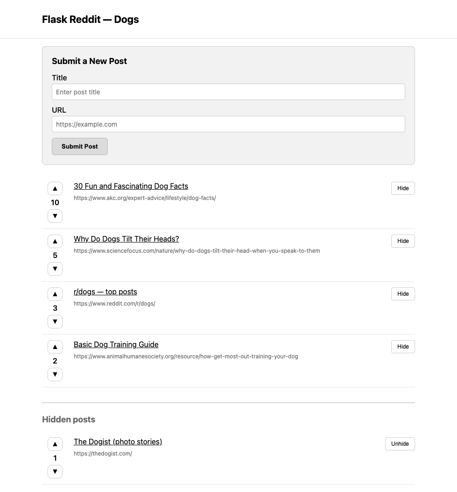

# Flask Reddit — Dogs

A small Reddit-style feed for sharing dog links. Submit a link, vote it up or down, or move it to a hidden list.



## What I built

I extended the DSTL onboarding starter with the following features.

- **Submit links.** Add a title and a web address. New posts start at one point.
- **Rank the feed.** Upvotes and downvotes change a post’s score. The feed shows the highest scores first.
- **Hide and restore posts.** Move a post to the **Hidden posts** section and bring it back with **Unhide**.
- **Save changes with SQLite.** Posts, scores, and hidden status survive a restart.

## Run it locally

You’ll need Python 3.10+ and [uv](https://docs.astral.sh/uv/getting-started/installation/).

```sh
git clone https://github.com/Thaarak/flask-reddit-demo.git
cd flask-reddit-demo
uv run --locked flask --app app run
```

Open [http://127.0.0.1:5000](http://127.0.0.1:5000). Flask creates `posts.db` with five sample links on the first run. Try voting on one, hiding it, then restarting the app to see the change persist.

## How it works

The forms send actions to Flask. Flask saves the change in SQLite and reloads the feed. The page is rendered on the server with a single HTML template. Each post has its own database ID, so two submissions can share a link and still have separate votes.

Built with Python, Flask, SQLite, and server-rendered HTML and CSS. Starter code and exercise by [UC San Diego’s Data Science Teaching and Learning Lab](https://github.com/dstl-lab/flask-reddit-demo).
